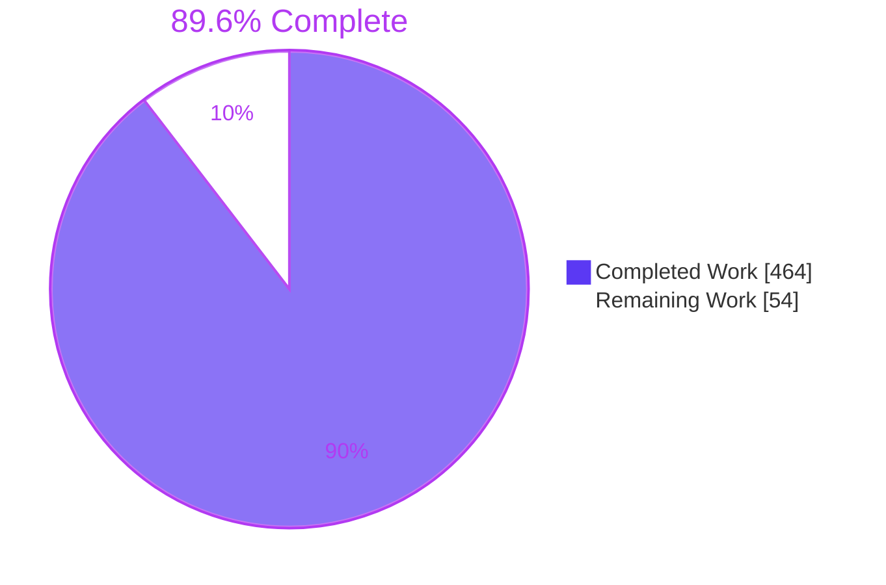
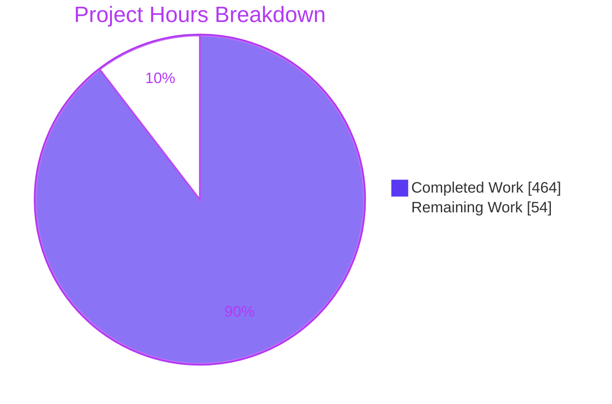
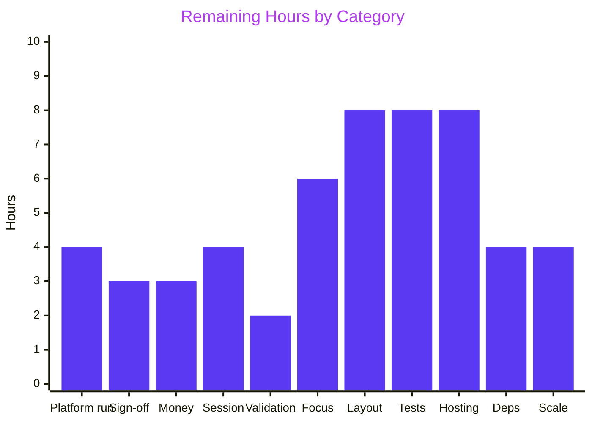

# 1. Executive Summary

## 1.1 Project Overview

The OutSystems Expenses Manager has been rebuilt in `java-react/` as a Spring Boot 3.5.16 REST backend and a React 19 + MUI single-page app. One Maven POM builds them into one jar, which serves both on port 8080 over an embedded H2 database. Users, approvers and administrators manage expense and earning reports with lines and invoices, use dashboards, a blog and two calculators. Legacy rules, messages and seeded figures are preserved, with role-based security and one-command `start.sh`/`stop.sh` delivery.

## 1.2 Completion Status



| Metric | Value |
|---|---|
| Total Hours | 518 |
| Completed Hours (Baseline: Human with agentic-assist) | 464 |
| Remaining Hours | 54 |
| Percent Complete | 89.6% |

464 hours completed out of 518 total hours = 89.6% complete.

## 1.3 Key Accomplishments

- [x] All 164 planned files delivered; read-only paths untouched.
- [x] The whole gate passes: 1,133 of 1,133 tests (Surefire 265, Vitest 489, Failsafe 379).
- [x] 14 routes, 4 dialogs and 21 legacy server actions migrated, with role and ownership checks on the server.
- [x] Seeded figures match the legacy screenshots (€ 3.412,95; 69.93% top share; 17 / 15 / 5.88%).
- [x] BCrypt passwords, header-only CSRF, session rotation, remember-me and one JSON error body.
- [x] Startup with seeding takes about 5 s, and the list and dashboard p95 stays under 300 ms.
- [x] `start.sh` and `stop.sh` build, run, refuse a second start and keep data across restarts.
- [x] No comment block runs over 5 lines, and there is no TODO or placeholder code.

## 1.4 Critical Unresolved Issues

1 of 43 AAP requirements is partially met, because of one raw spacing value. 33 low-severity items remain open, grouped below; none breaks a business rule or a security control. 21 divergences also await sign-off (Section 5.2).

| Issue | Impact | Owner | ETA |
|---|---|---|---|
| Reviewer-platform verification (2): never run on macOS Apple Silicon; the AAP 0.9.4 checks were not run on port 8080 in a browser | One-command delivery is unproven on the platform the AAP names. Blocks acceptance | Reviewer / DevOps | 4 h |
| Monetary aggregation (2): the report `vatTotal` and the dashboard per-date sums can differ by 1 cent from the sum of the displayed values | Cosmetic arithmetic mismatch; stored amounts are correct | Backend developer | 3 h |
| Session edge cases (2): a stale tab keeps the old identity until a 403 or a navigation; an out-of-order logout 204 can clear a newer session cookie | Unexpected sign-out or a stale name in the app bar; the server still enforces access | Full-stack developer | 4 h |
| Validation and requests (2): a Unicode-blank title next to another invalid field reports only the other error first; the report detail page sends its GET twice | Minor UX and wasted traffic | Full-stack developer | 2 h |
| Keyboard focus (8): focus is lost or has no visible ring in some recovery paths, plus Mileage accessibility details | Accessibility polish | Frontend developer | 6 h |
| Layout and visual (11): includes the raw `outlineOffset` at `AppLayout.tsx:67` and the USD converter's unformatted "93€" result | Design-system and fidelity polish | Frontend developer | 8 h |
| Test reliability (2): two Vitest cases fail intermittently under heavy host load | A flaky gate in a busy CI | Frontend developer | 3 h (in testing task) |
| Dependency and build advisories (4): two moderate `@vitest/mocker` advisories, a 710 kB bundle advisory, `-Xlint` [serial] warnings and Mockito agent warnings | Dev-time only, no runtime exposure | Build owner | 4 h |
| Divergences awaiting sign-off (21) | The owner must accept them or amend the AAP | Product owner | 3 h |

## 1.5 Access Issues

| System/Resource | Type of Access | Issue Description | Resolution Status | Owner |
|---|---|---|---|---|
| macOS Apple Silicon host with JDK 25 arm64 | Hardware / platform | Every build and run was on Linux, so the reviewer platform the AAP names was not available to exercise | Open: run the checks in Section 9 on a Mac | Reviewer |
| Host port 8080 | Network port on a shared host | Port 8080 was shared, so the script checks ran in a private network namespace and the browser checks ran on another port | Workaround applied; re-run on a dedicated machine | Reviewer |

## 1.6 Recommended Next Steps

1. [High] On a Mac with Apple Silicon, run `./start.sh` from a clean checkout, then the AAP 0.9.4 checks at `http://localhost:8080` in a browser. Update `PR_DESCRIPTION.md` with the results.
2. [High] Accept or amend each of the 21 divergences in Section 5.2, starting with the logging keys, the error codes and the enhancer plugin.
3. [Medium] Fix the aggregation, session and validation items (9 h), then the focus and layout items (14 h).
4. [Medium] Make the two timing-sensitive Vitest cases deterministic, and cover the invoice-read error branches and the run scripts.
5. [Medium] Host on JDK 25 behind TLS, verify the Secure cookie, and back up `java-react/data/`.

# 2. Project Hours Breakdown

## 2.1 Completed Work Detail

| Component | Hours | Description |
|---|---|---|
| Build and project scaffolding | 14 | `pom.xml` (Boot parent 3.5.16, frontend-maven-plugin 1.15.4, Hibernate bytecode enhancer), the Maven Wrapper 3.3.4 `mvnw`, `package.json` with exact pins and lockfile, the Vite/TypeScript configuration, and the `.gitignore` entries |
| Database schema, static data and seed | 16 | `schema.sql` (13 tables, 11 foreign keys, 23 indexes, safe to rerun), `data.sql` with the static rows, `seed/demo-data.json`, and the validating `SeedDataLoader` (4 users, 22 reports, 24 lines, 2 posts) |
| Domain entities and repositories | 26 | 19 domain types, including the shared superclasses, and 18 repository files on the generic `@NoRepositoryBean` bases using `#{#entityName}` |
| Security, session and access control | 32 | `SecurityConfig`, `JsonSecurityHandlers`, `SpaCsrfTokenRequestHandler`, `AuthService`, `ReportAccessPolicy`, the readiness gate, remember-me and the session cookie lifecycle |
| Report, line and invoice services | 44 | `ReportService`, `ReportCodeGenerator`, `LineService`, `AmountCalculator`, `InvoiceService`: the legacy rules 1–14, half-up rounding, pessimistic locking, the per-kind create lock, and lazy invoice BLOBs |
| Dashboard, blog, tools and reference services | 22 | `DashboardService` (user and admin figures, per-date aggregation), `BlogService`, `ToolsService`, and the cached `ReferenceDataService` |
| REST controllers, validation and error contract | 34 | 6 controllers, 6 request records with constraints, `ApiExceptionHandler`, `ErrorResponse`, `LegacyMessages`, SPA serving, compression and same-origin CORS in `SpaWebConfig` |
| SPA foundation | 40 | Theme tokens in `theme.ts`; `client.ts`, `api.ts` and `types.ts`; `AuthContext` and `RequireRole`; the route table in `routes.tsx`; `AppLayout`, `PageHeader` and `Feedback`; the formatters in `format.ts` |
| SPA screens and dialogs | 72 | 14 pages, `ReportList`, `ReportDetailView`, `LineTable`, the 4 dialogs, `KpiCard`, `StatusTag`, and the dashboard charts |
| Accessibility and responsive behaviour | 24 | Focus management and dialog focus return, live regions, AA contrast, 44 px touch targets, the compact app bar, and narrow-screen layouts |
| Backend test suites | 44 | `BusinessRulesTest` (265), `RoleMatrixIT` (345), `EndToEndIT` (22), `ScreenshotFiguresIT` (6), `ResponseTimeIT` (6), and the `support/` harness |
| Frontend test suites | 36 | `format.test.ts` (160), `routeGuards.test.tsx` (118), `routeRender.test.tsx` (208), `noHardCodedColours.test.ts` (3), plus fixtures and `renderRoute` |
| Run scripts | 6 | `start.sh` (JDK check, port preflight, build, banner, `exec`) and `stop.sh` (listener lookup, kill, re-check) |
| Documentation | 14 | `README.md` (run, stop, logins, configuration, tests, seed, known behaviours) and `PR_DESCRIPTION.md` (token sources, intentional changes, screenshot comparison, manual checks, startup time) |
| Runtime validation and hardening | 40 | Security probes, performance at seeded and grown volumes, log redaction at default, DEBUG and TRACE levels, and browser walkthroughs of every screen |
| **Total** | **464** | |

## 2.2 Remaining Work Detail

| Category | Hours | Priority |
|---|---|---|
| Reviewer-platform run and literal AAP 0.9.4 manual checks (macOS Apple Silicon, port 8080, browser); update `PR_DESCRIPTION.md` | 4 | High |
| Owner sign-off of the 21 divergences in Section 5.2 (accept each, or amend the AAP) | 3 | High |
| Monetary aggregation consistency (report `vatTotal`, dashboard per-date sums) | 3 | Medium |
| Session robustness (re-check identity in a stale tab; out-of-order logout cookie) | 4 | Medium |
| Validation and request polish (Unicode-blank title precedence; duplicate report-detail GET) | 2 | Medium |
| Keyboard focus items (8) | 6 | Medium |
| Layout and visual items (11), including the design-system spacing fix and the converter number format | 8 | Medium |
| Test hardening: two timing-sensitive Vitest cases, the invoice-read error branches, the `ApiClient` close branch, and a scripted run-script test | 8 | Medium |
| Production hosting: JDK 25 host, TLS reverse proxy, Secure-cookie verification, service unit, H2 data backup, log retention | 8 | Medium |
| Dependency and build hygiene: `@vitest/mocker` advisories, bundle splitting, `-Xlint` warnings, Mockito agent flag | 4 | Low |
| Scale review: approver and admin list query plans, the single-process write lock, growth beyond ~700 reports | 4 | Low |
| **Total** | **54** | |

## 2.3 Hours Calculation

- Completed: 14 + 16 + 26 + 32 + 44 + 22 + 34 + 40 + 72 + 24 + 44 + 36 + 6 + 14 + 40 = **464 h**
- Remaining: 4 + 3 + 3 + 4 + 2 + 6 + 8 + 8 + 8 + 4 + 4 = **54 h**
- Total: 464 + 54 = **518 h**. Completion: 464 / 518 = **89.6%**
- Confidence: high for the completed hours, which are sized from 30,406 delivered lines and 1,133 passing tests. Medium for the remaining hours: the reviewer-platform run and the production hosting depend on the target environment.

# 3. Test Results

All results below come from one run of the whole gate, `cd java-react && CI=true ./mvnw -B verify`, at commit `afe2a11`. It ended BUILD SUCCESS in 1 min 24 s, with no Maven `[WARNING]` or `[ERROR]` lines. No code-coverage tool is configured in the build, so coverage is not measured.

| Area / Category | Framework | Tests | Passed | Failed | Coverage | What This Proves |
|---|---|---|---|---|---|---|
| Business rules (`BusinessRulesTest`) | JUnit 5 / Surefire | 265 | 265 | 0 | Not measured | Report codes, the submit, decision and delete rules, amounts and rounding, validation limits, ownership and seed validation all hold for both report kinds |
| Security and API contract (`RoleMatrixIT`) | JUnit 5 / Failsafe | 345 | 345 | 0 | Not measured | Every endpoint answers correctly for anonymous, Registered, User, Approver, Administrator and mixed-role callers, and logs omit secrets |
| End-to-end journeys (`EndToEndIT`) | JUnit 5 / Failsafe | 22 | 22 | 0 | Not measured | The full report journey works: create, line, invoice upload and download, submit, approve. CSRF transitions and persistence across a real restart also work |
| Seeded figures (`ScreenshotFiguresIT`) | JUnit 5 / Failsafe | 6 | 6 | 0 | Not measured | Dashboard figures and report rows match the legacy screenshots |
| Performance (`ResponseTimeIT`) | JUnit 5 / Failsafe | 6 | 6 | 0 | Not measured | Startup with seeding takes under 30 s, and the list and dashboard p95 stays under 300 ms |
| Formatters (`format.test.ts`) | Vitest 3.2.7 | 160 | 160 | 0 | Not measured | Euro, percent and date output is exact and does not depend on the locale or time zone |
| Route guards (`routeGuards.test.tsx`) | Vitest 3.2.7 | 118 | 118 | 0 | Not measured | Each of the 14 routes admits or redirects every role correctly, and the return path, session expiry and logout behave as specified |
| Screens, interactions and design tokens (`routeRender.test.tsx`, `noHardCodedColours.test.ts`) | Vitest 3.2.7 | 211 | 211 | 0 | Not measured | Every screen renders, and forms, dialogs, filters, paging, previews and focus behave correctly. No colour literal exists outside `theme.ts` |
| **Total** | | **1,133** | **1,133** | **0** | | |

**Not Covered** (delivered, but exercised by no automated test; a human should test these before release):

- `start.sh` and `stop.sh`: they were checked by hand in a private network namespace on Linux only, and no test runs them.
- The real SPA transport in `frontend/src/api/client.ts` and `api.ts`: every Vitest suite mocks `api.ts`, so the fetch, CSRF-header and blob-download code runs only in browser checks.
- The short-read and SQL/IO error branches of `InvoiceService.contentOf`.
- The failure branch of `ApiClient.loggedIn` that suppresses the close error, in the test support code.
- The `Secure` and `Domain` session-cookie attributes, which only appear behind HTTPS.
- The `Pager` fallback for when neither arrow is enabled (`LineTable.tsx`), which the UI cannot reach.
- Native macOS Apple Silicon behaviour, and hover styles on a physical pointer device (headless Chrome reports `hover: none`).

# 4. Runtime Validation & UI Verification

The packaged jar ran on a fresh H2 file, driven with curl and headless Chrome at 1280 to 1920 px. The narrow-screen checks ran at 375 and 768 px.

- ✅ **Start-up and seeding.** Spring reported "Started" 4.6 s after launch, and about 0.5 s later the app logged "Seeded demo data: 4 users, 22 reports, 24 lines, 2 blog posts". `GET /` and deep links such as `/reports` return 200 with `index.html`. A restart keeps the data and does not seed again.
- ✅ **Authentication.** The anonymous `GET /api/auth/me` returns 401 and sets `XSRF-TOKEN`. Login returns 200 with `landingRoute`. Logout returns 204 and clears both cookies. A protected route opened after logout redirects to `/login`.
- ✅ **User journey (`em_user1`).** The dashboard shows € 3.412,95 and shares of 69.93 / 25.64 / 3.88 / 0.55%, with status counts 1 / 1 / 7 / 5. `/reports` lists 8 rows, "1 to 8 of 8 items". The detail page shows "12/2024 EX: London Trip" with a Draft tag. Creating a report and its lines, uploading and downloading an invoice, and submitting were all exercised in the browser.
- ✅ **Administrator journey (`em_admin`).** The counters show 17 / 15 / 5.88%. Lists show 5 rows per page. Approve and Decline appear on Submitted rows only. Decisions update the counters.
- ✅ **Blog and tools.** Both posts are listed. Mileage of 100 km shows "€ 37,00". The USD converter returns the correct value (`eur` 93.00).
- ⚠ **USD converter message.** The message renders "100$ using exchange rate of 0.93 equals to 93€", with the raw number rather than the `format.ts` style (open item, D20).
- ✅ **Security at runtime.** 1,935 role-matrix and ownership checks passed. Probes showed no injection, XSS or open redirect. Uploads are limited to PDF, PNG and JPEG under 5 MB. CSRF is accepted only through the header. Cross-origin requests are refused.
- ✅ **Performance and logging.** Gzip responses, 5 MiB invoice downloads at about 1× heap, and dashboards within budget at about 700 reports were all measured. Logs held no passwords, hashes, bodies or invoice bytes at DEBUG or TRACE, and the app opened no outbound connections.
- ⚠ **Run scripts.** `start.sh` and `stop.sh` passed every AAP step, but only on Linux, inside a private network namespace.
- ❌ **Never exercised at runtime:** macOS Apple Silicon, HTTPS with Secure cookies, the 30-day remember-me expiry on a real clock, and hover on a physical pointer.

# 5. Compliance & Quality Review

## 5.1 Compliance Matrix

| AAP Deliverable | Benchmark | Status | Progress | Evidence |
|---|---|---|---|---|
| Scope and file plan (0.2, 0.6.1) | All 164 planned files are present, and read-only paths are unchanged | ✅ Pass | 100% | `git diff origin/main --name-status`: 163 added under `java-react/`, 1 modified (`.gitignore`) |
| Build chain and pins (0.4.2, 0.7.1) | One POM, exact versions, lockfile, and a gate that fails on any error | ✅ Pass (D1, D2) | 100% | The gate log shows Node v24.22.3, `npm ci`, `tsc`, `vite build`, Surefire, Vitest and Failsafe |
| Persistence and seed (0.4.2, 0.4.5) | Schema safe to rerun, `validate` mode, seed applied once | ✅ Pass | 100% | `schema.sql`, `SeedDataLoader`, `ScreenshotFiguresIT` 6/6 |
| Security and session (0.4.3, 0.5.1) | Role matrix, ownership, CSRF, BCrypt, uniform 401 | ✅ Pass | 100% | `RoleMatrixIT` 345/345; runtime matrix of 1,935 checks |
| REST contract and error body (0.4.3) | Exact endpoints, statuses and legacy messages; one error body | ✅ Pass (D7–D10, D14) | 100% | `EndToEndIT` 22/22, `ApiExceptionHandler`, `ErrorResponse` |
| Business rules 1–14 (0.4.4) | Every legacy rule and intentional change | ✅ Pass | 100% | `BusinessRulesTest` 265/265 |
| Screens, routes and dialogs (0.2.2.1, 0.4.7, 0.4.9) | 14 routes, role guards, fixed labels and formats | ✅ Pass (D12, D20) | 100% | `routeGuards` 118/118, `routeRender` 208/208, browser walkthroughs |
| Design system (0.3) | MUI only; every colour and spacing value from `theme.ts` | ⚠ Partial | 95% | `noHardCodedColours` 3/3; raw `outlineOffset: 2` at `AppLayout.tsx:67` |
| Run scripts (0.4.6) | `start.sh`/`stop.sh` messages, exits and persistence | ✅ Pass (D4, D5) | 100% | Manual checks 1–5 recorded in `PR_DESCRIPTION.md` |
| Performance (0.9.1 criterion 8) | Start under 30 s; p95 under 300 ms | ✅ Pass | 100% | `ResponseTimeIT` 6/6; startup with seeding about 5 s, and 6.8 s median recorded in the PR |
| Documentation and manual checks (0.9.4, 0.11.2) | README and PR sections; manual results recorded | ⚠ Pass with caveat (D19) | 95% | The results are recorded, but were not run on macOS or in a browser at port 8080 |
| Concise Comments Rule (0.10.1, user rule) | No comment block over 5 lines; no history or placeholder comments | ✅ Pass | 100% | A tree-wide scan found no block over 5 lines and no TODO/FIXME |

## 5.2 AAP & Rule Divergences and Gaps

No user-rule divergence was found. Each AAP divergence has its own row.

| # | What the AAP/Rule Required | What Was Delivered Instead | Why It Diverged | Impact | Remediation |
|---|---|---|---|---|---|
| D1 | 0.7.1: only the listed dependencies, with frontend-maven-plugin as "the only explicit plugin version in `pom.xml`" | `hibernate-enhance-maven-plugin` 6.6.53.Final with `${hibernate.version}` (`pom.xml:75-76`), explained at `PR_DESCRIPTION.md:102` | 0.6.1.2 requires a lazy `@Lob` for invoice content, and Hibernate loads it eagerly without bytecode enhancement | One more build plugin; invoice BLOBs load only on download | Accept, or amend 0.7.1 |
| D2 | 0.7.1: the exact npm pin list | An `overrides` entry pins `tinypool` to 2.1.2 (`frontend/package.json:31-32`); the lockfile has 263 entries | Vitest 3.2.7 would otherwise resolve tinypool 1.1.1, which is affected by CVE-2026-104848 and CVE-2026-104849 | Dev-only dependency; no runtime change | Accept |
| D3 | 0.4.2: `application.properties` holds "the complete key list" | Four extra `logging.level.*=INFO` keys (`application.properties:27-30`) | They keep passwords, request bodies and session ids out of the logs when root DEBUG is enabled (0.4.3, 0.5.2, 0.11.1) | Operators who raise log levels stay safe | Owner decision: accept, or amend 0.4.2 |
| D4 | 0.4.6: `lsof -ti tcp:8080` in `start.sh` and `stop.sh` | `lsof -ti tcp:8080 -sTCP:LISTEN` | So that `stop.sh` kills only the server, not a browser or client connected to it | Safer stop; same messages and exit codes | Accept |
| D5 | 0.4.6: the listed script steps | Extra behaviour: an `lsof` presence check, `-h`/`--help`, a check for a JRE without `javac`, errors on stderr, a "Stop with Ctrl+C or ./stop.sh." banner, and a 4 s re-check in `stop.sh` | Added for diagnosability; not required by the AAP | Clearer failures; AAP messages unchanged | Accept |
| D6 | 0.6.1.3: request records carry bean-validation annotations, including the length limits | `LineRequest` enforces the 50/1500 limits through the class-level `@TextWithinLimits`, which delegates to `LineService.textViolations` (`LineRequest.java:50-58`) | One rule set, using the same title normalisation, serves both the request and the service layer | Same messages; no functional change | Accept |
| D7 | 0.4.3: a closed list of error codes | A new 503 `SERVICE_UNAVAILABLE` with `Retry-After: 1` and "The application is starting, please try again in a moment." until readiness (readiness gate in `SecurityConfig`) | Requests arriving before seeding completes would otherwise see partial data | Clients may see one extra code at startup | Owner decision |
| D8 | 0.4.3: a closed list of error codes | Other container 4xx responses keep their status, with the HTTP status name as the code and "Invalid value" as the message; a container 405 becomes 404 `NOT_FOUND` (`ErrorResponse.java:30-38`) | Tomcat-level rejections such as 416 have no AAP code | Codes outside the list on rare edge requests | Owner decision |
| D9 | 0.4.3: errors mapped to the listed codes | A request with a non-JSON `Accept` header on a JSON write gets 500 `INTERNAL_ERROR`, and is refused before the write commits | The reason is not recorded beyond keeping the closed code list | No data written; a misleading status | Owner decision, or map it to 406 |
| D10 | 0.4.2: `index.html` for non-API paths | `GET /` sent with only `Accept: application/json` gets the Spring Boot default 406 | Content negotiation is left at the framework default | None for browsers | Accept |
| D11 | 0.4.1: line queries that filter on status "join `#{#entityName}Report`" | An `IN (select … from #{#entityName}Report …)` subquery in `LineRepository` | The join form measured p95 126.5 ms at about 715 reports; the subquery measured 15–22 ms | Same results, faster | Accept |
| D12 | 0.3.2/0.3.5: line lists use the MUI `Table` | Below 900 px, line lists render as captioned cards (`LineTable.tsx`); the `Table` is kept from md up | 0.3.5 responsiveness at 375 px | Readable lists on narrow screens | Accept |
| D13 | 0.3.5: every spacing unit comes from `theme.ts` | Raw `outlineOffset: 2` at `frontend/src/layout/AppLayout.tsx:67` | Not implemented in this run | Design-token drift at one site | Use a theme value (0.5 h; Section 2.2 layout items) |
| D14 | 0.4.3: new message strings limited to the listed set | Extra text: "Please log in to continue.", "The requested resource was not found", "Invalid value", "Expense was added"/"Earning was added", three dashboard empty states, "Reports could not be loaded." and an inline Retry (all listed in `PR_DESCRIPTION.md` "Other departures") | States the legacy app showed no text for | Clearer UX; legacy strings unchanged | Accept |
| D15 | 0.4.4.3 (AN-01): PDF, PNG or JPEG up to 5 MB | Additionally, the declared content type must match the file extension, otherwise 415 | Stricter upload hygiene | A mislabelled file is refused | Accept |
| D16 | No input caps beyond the field limits | The SPA caps the report-list search at 50 characters and the blog search at 500 | An uncapped query can exceed the 8 KB header limit, which signs the user out with a 401 | None for normal use | Accept |
| D17 | Not specified | Gzip response compression through a `WebServerFactoryCustomizer` bean | Reduces the 710 kB bundle to about 219 kB; configured in code because 0.4.2 fixes the property keys | Faster loads | Accept |
| D18 | Not specified | Duplicate JSON keys are rejected with 422 (Jackson strict duplicate detection, set in code) | Removes ambiguity about which value is bound | Malformed bodies are refused | Accept |
| D19 | 0.9.4: run the checks from a clean checkout, open `http://localhost:8080`, and use the reviewer's macOS | Checks 1–5 ran with curl in a private network namespace on Linux; the browser sign-in, the screenshot comparison and the startup timing ran on another port | Port 8080 is shared on the build host, and no macOS host was available | The checks passed, but the target platform and port are unproven | Re-run on a Mac (Section 2.2, 4 h) |
| D20 | 0.4.9 gives the message "{usd}$ using exchange rate of {rate} equals to {eur}€"; 0.5.4 routes all money output through `format.ts` | `UsdToEurConverterPage.tsx:224` inserts raw numbers ("93€", "9311.63€") | The template was followed literally, as in the legacy app | Inconsistent number style on one screen | Owner decision; formatting fix 0.5 h |
| D21 | 0.5.4: `format.ts` holds the 9 listed formatters | 10 exported, including `formatPeriodRange` for "April 01 - April 30" | A helper built on `formatPeriod` | None | Accept |

**D3: extra logging keys.** AAP 0.4.2 calls its property list complete, yet `application.properties:27-30` adds four `logging.level` pins at INFO. Without them, raising the root logger to DEBUG makes Spring and Hibernate print request bodies, entity values and the invalidated session id, which AAP 0.4.3, 0.5.2 and 0.11.1 forbid. `RoleMatrixIT` holds `rootDebugLogOmitsRequestValuesAndSessionIds` and `rootDebugLogOmitsPersistedValues`, which prove the guarantee. Decide whether to accept the keys or amend 0.4.2.

**D7–D9: error codes outside the closed list.** The AAP's code list does not cover the startup window, Tomcat-level rejections, or a non-JSON `Accept` header. `SecurityConfig` answers 503 `SERVICE_UNAVAILABLE` before readiness. `ErrorResponse.java:30-38` maps other container 4xx responses to the HTTP status name. Non-JSON `Accept` on writes yields 500 without committing. `EndToEndIT.apiAnswers503UntilReady` and `RoleMatrixIT.containerErrorIsLogged` cover these paths. Any client that switches on `code` must tolerate these values. Decide whether to accept them, extend the AAP list, or change the not-acceptable status to 406.

**D19: manual checks not on the reviewer platform.** AAP 0.9.4 expects the checks to run from a clean checkout at `http://localhost:8080`, and the AAP names macOS on Apple Silicon as the reviewer platform. All recorded results (`PR_DESCRIPTION.md`, "Manual checks" and "Startup time") came from Linux: the script checks in a private network namespace with curl, and the browser checks on another port. The scripts use no Bash 4 features, and frontend-maven-plugin supports `darwin-arm64`, but neither has run on a Mac. Run Section 9's quick start on a Mac and update the PR. This is the one acceptance-blocking item.

**D20: converter number format.** AAP 0.4.9 quotes the legacy template, and the legacy app inserted raw decimals. AAP 0.5.4 and its money-output rule route all money through `format.ts`. The delivered page (`UsdToEurConverterPage.tsx:224`) follows the template literally, so 100 USD shows "93€" while every other screen shows "€ 93,00". Choose which rule wins. Applying `formatEuro` takes 0.5 h and requires updating the matching `routeRender` assertions.

# 6. Risk Assessment

| Risk | Category | Severity | Probability | Mitigation | Status |
|---|---|---|---|---|---|
| The one-command build and run has never executed on macOS Apple Silicon, the reviewer platform the AAP names | Operational | High | Medium | Run the quick start in Section 9 on a Mac with an arm64 JDK 25 and record the results in `PR_DESCRIPTION.md` | Open |
| There are no schema migrations. `CREATE … IF NOT EXISTS` never alters an existing `java-react/data/` file, so a later schema change silently keeps the old structure | Technical | Medium | Medium | Delete `data/` after schema changes, or introduce Flyway or Liquibase before real data exists | Open |
| Single-process design: an embedded H2 file and a per-kind JVM lock around report-code allocation make multiple instances unsafe | Technical | Medium | Low | Keep it to one instance, or move to a server database with a database sequence or lock before scaling out | Accepted |
| The app serves plain HTTP. Secure and Domain cookie attributes have never been exercised, and the H2 file holds BCrypt hashes and invoices unencrypted | Security | Medium | Medium | Terminate TLS at a reverse proxy, verify the Secure cookie, and restrict and back up `data/` | Open |
| The real SPA transport (`client.ts`, `api.ts`) is exercised only in browser checks, because every Vitest suite mocks `api.ts` | Integration | Medium | Low | Add a browser-level smoke test (for example Playwright) against the jar for login, a list and an invoice download | Open |
| The oversized-request handling relies on the Tomcat-internal input buffer (connector rejection valve), so a Spring Boot or Tomcat upgrade may change it | Technical | Medium | Low | Keep the `RoleMatrixIT` and `EndToEndIT` edge cases in the gate; re-run them on every Boot upgrade | Monitored |
| Two Vitest cases fail intermittently under heavy CPU load, so the gate can fail without a code defect | Operational | Low | Medium | Replace fixed waits with `findBy`/`waitFor` on observable state; run CI with bounded workers | Open |
| Approver and admin list queries scan the report table, and dashboards are verified only up to about 700 reports | Technical | Low | Medium | Add composite indexes on `Status` and `CreatedOn` if volume grows; extend `ResponseTimeIT` to a grown dataset | Accepted |

# 7. Visual Project Status



Remaining hours by priority: High 7 h, Medium 39 h, Low 8 h (total 54 h).



# 8. Summary & Recommendations

The migration is 89.6% complete: 464 of 518 hours. Every file in the AAP's plan exists under `java-react/`, and the whole gate passes 1,133 of 1,133 tests. The backend reproduces all 14 legacy business rules, the role matrix and the seeded figures. The SPA covers all 14 routes and the six legacy popups, implemented as four dialogs. Of the 43 AAP requirements and user rules, 42 are met, with 21 recorded divergences spread across them. One, the design-system spacing rule, is partially met because of a single raw value.

What was verified goes beyond the unit suites. The packaged jar was driven in Chrome as a user and as an administrator, and the screens show the screenshot figures (€ 3.412,95; 17 / 15 / 5.88%). Security checks covered the full role matrix, CSRF, uploads and injection attempts. Performance stayed within budget at seeded volume and at about 700 reports. Logs stayed free of secrets even at DEBUG and TRACE. What was not verified is equally clear. The target macOS Apple Silicon platform, HTTPS operation and the real browser transport layer have no automated coverage, and the run scripts were checked only on Linux.

The remaining 54 hours are low-risk polish and path-to-production work. No business rule or security control is open. The critical path is short:

1. Run the one-command checks on a Mac at port 8080 (4 h). This is the only acceptance-blocking item.
2. Have the owner sign off the 21 divergences (3 h), above all the extra logging keys and the extra error codes.
3. Fix the 33 low-severity items in priority order: aggregation, session, validation, focus, layout and tests.
4. Add TLS hosting and a backup of the H2 data before any real use.

| Success metric | Target | Observed |
|---|---|---|
| Gate tests passing | 100% | 1,133 / 1,133 |
| Startup with seeding | < 30 s | About 5 s (single run); 6.8 s median in the recorded manual check |
| p95 of list and dashboard calls | < 300 ms | Within budget (`ResponseTimeIT` 6/6) |
| Requirements met | 43 / 43 | 42 met, 1 partial |

**Production readiness:** ready for reviewer acceptance once the macOS check passes. It is not yet ready for hosting real users, because it lacks TLS, a migration strategy and a data backup. Those are covered by the 8 h hosting task and the risks in Section 6.

# 9. Development Guide

## 9.1 System Prerequisites

- JDK 25 or newer (verified with Temurin 25.0.5.1). On Apple Silicon, any arm64 JDK 25 build works. `start.sh` refuses older JDKs and JREs without `javac`.
- `lsof`, which both scripts require, and `bash`.
- Nothing else is needed. Maven 3.9.16 comes through `./mvnw`, and Node v24.22.3 and npm are installed into `java-react/node/` by the first Maven build. No database server, Docker, environment variables or secrets are needed.
- Disk: about 60 MB for the jar, plus the build caches. The first build downloads its dependencies unless `~/.m2` and `~/.npm` are already warm.

## 9.2 Quick Start (one command)

```bash
cd java-react
./start.sh
```

The script prints "Building...", then the URL `http://localhost:8080` and the demo logins, and runs the app in the foreground. Stop it with Ctrl+C or, from another terminal:

```bash
cd java-react
./stop.sh
```

The expected messages are "Stopped.", or "Nothing listening on port 8080." when the app is not running. A second `./start.sh` while the app runs prints "Run ./stop.sh first." and exits 1.

Demo logins (password `123456`): `em_user1` (User, lands on `/dashboard`) and `em_admin` (Administrator, lands on `/admin`).

## 9.3 Build and Test

```bash
cd java-react
./mvnw -B -q package -DskipTests        # build the jar only (about 14 s with warm caches)
CI=true ./mvnw -B verify                # whole gate: tsc, vite build, BusinessRulesTest, Vitest, package, ITs (about 85 s)
CI=true ./mvnw -B test                  # frontend build, BusinessRulesTest and Vitest
CI=true ./mvnw -B verify -Dit.test=RoleMatrixIT   # gate with one integration test
cd frontend && PATH="../node:$PATH" npx tsc --noEmit && PATH="../node:$PATH" npm test   # Vitest only, after any Maven build
```

The expected gate summary: `Tests run: 265` (Surefire), `Tests 489 passed (489)` (Vitest), `Tests run: 379` (Failsafe), `BUILD SUCCESS`.

## 9.4 Running the Jar Directly (alternate port)

```bash
cd java-react
java -jar target/expenses-manager.jar --server.port=20640 &
curl -s -o /dev/null -w '%{http_code}\n' http://localhost:20640/     # 200 when ready (about 5 s)
kill $(lsof -ti tcp:20640 -sTCP:LISTEN)                               # stop only this port
```

The database is `./data/expenses.mv.db`, relative to the working directory. It is created and seeded on first start, and keeps its data across restarts.

## 9.5 Verification and Example API Usage

```bash
B=http://localhost:20640
curl -s -c cj -b cj -o /dev/null -w '%{http_code}\n' $B/api/auth/me          # 401, sets XSRF-TOKEN
T=$(awk '/XSRF-TOKEN/{print $7}' cj)
curl -s -c cj -b cj -H "X-XSRF-TOKEN: $T" -H 'Content-Type: application/json' \
  -d '{"username":"em_user1","password":"123456","rememberMe":false}' $B/api/auth/login   # 200, user with "landingRoute":"/dashboard"
curl -s -b cj "$B/api/reports?kind=expense"      # 8 seeded rows, first "12/2024 EX" London Trip
curl -s -b cj $B/api/dashboard/user               # "balance":3412.95, ...
T=$(awk '/XSRF-TOKEN/{print $7}' cj)
curl -s -b cj -c cj -X POST -H "X-XSRF-TOKEN: $T" -o /dev/null -w '%{http_code}\n' $B/api/auth/logout   # 204
```

The login response is `{"username":"em_user1","displayName":"John Smith","roles":["User","Registered"],"landingRoute":"/dashboard"}`. In a browser, open the URL and sign in as `em_user1`: the dashboard shows a balance of € 3.412,95, and `/reports` lists 8 expense reports.

## 9.6 Optional Dev Mode

```bash
cd java-react/frontend
PATH="../node:$PATH" npm run dev     # Vite on http://localhost:5173, proxies /api to http://localhost:8080
```

The backend must already run on port 8080.

## 9.7 Troubleshooting

- **"Run ./stop.sh first."**: something is listening on port 8080. Run `./stop.sh`, or free the port.
- **"Java 25 or newer is required…"**: install a JDK 25+, or point `JAVA_HOME`/`PATH` at it.
- **"Build failed. Run ./mvnw package to see the full output."**: run `./mvnw -B package` to see the real compiler or test error.
- **Startup fails, naming an `expenses.*` key**: a rate or date in `application.properties` is out of range. Rates must be positive and below 1000.
- **Old data, or a changed schema not applied**: stop the app and delete `java-react/data/`. The schema never alters existing tables.
- **A Vitest case fails only on a heavily loaded machine**: re-run the gate. Two timing-sensitive cases are known.
- **`ResponseTimeIT` fails on a loaded host**: re-run it alone with `-Dit.test=ResponseTimeIT` before treating the failure as a defect.
- **The 401 for `/api/auth/me` in the browser console before login** is the expected session probe.

# 10. Appendices

## A. Command Reference

| Command (from `java-react/`) | Purpose |
|---|---|
| `./start.sh` | Check the JDK and port, build, then run on port 8080 |
| `./stop.sh` | Stop whatever listens on port 8080 |
| `./mvnw -B -q package -DskipTests` | Build `target/expenses-manager.jar` |
| `CI=true ./mvnw -B verify` | The whole gate (all suites) |
| `CI=true ./mvnw -B verify -Dit.test=<ClassName>` | The gate with one integration test |
| `cd frontend && PATH="../node:$PATH" npm test` | Vitest only |
| `java -jar target/expenses-manager.jar --server.port=<port>` | Run on another port |

## B. Port Reference

| Port | Use |
|---|---|
| 8080 | The application (`server.port`; hard-coded in `start.sh` and `stop.sh`) |
| 5173 | Optional Vite dev server, proxying `/api` to 8080 |
| Random | Integration tests (`RANDOM_PORT`, each with its own temporary H2 file) |

## C. Key File Locations

| Path | Contents |
|---|---|
| `java-react/pom.xml` | The single build: Boot parent, frontend-maven-plugin, enhancer, Surefire and Failsafe |
| `java-react/src/main/java/com/massmutual/expensesmanager/` | `domain/`, `repository/`, `service/` (+ `model/`), `web/` (+ `dto/`) |
| `java-react/src/main/resources/` | `application.properties`, `schema.sql`, `data.sql`, `seed/demo-data.json` |
| `java-react/src/test/java/com/massmutual/expensesmanager/` | The 5 suites and `support/` (`ApiClient`, `TestDatabase`, `MutableClock`) |
| `java-react/frontend/src/` | `api/`, `auth/`, `components/`, `pages/`, `layout/`, `theme/theme.ts`, `format/`, `routes.tsx`, `test/` |
| `java-react/start.sh`, `java-react/stop.sh` | Run scripts |
| `java-react/README.md`, `java-react/PR_DESCRIPTION.md` | Run guide; migration record and review results |
| `java-react/data/` | Runtime H2 database (git-ignored) |

## D. Technology Versions

| Technology | Version |
|---|---|
| Java (compile and run) | 25 (`maven.compiler.release`); verified on Temurin 25.0.5.1 |
| Spring Boot | 3.5.16 (Hibernate 6.6.53.Final, H2 2.3.232) |
| Maven / Wrapper | 3.9.16 / 3.3.4 (only-script) |
| frontend-maven-plugin | 1.15.4, installing Node v24.22.3 |
| React / React DOM | 19.3.1 |
| @mui/material | 7.3.11 (@emotion/react 11.14.0, @emotion/styled 11.14.1) |
| react-router | 7.18.6 |
| TypeScript / Vite / @vitejs/plugin-react | 5.9.3 / 7.3.8 / 5.2.0 |
| Vitest / jsdom | 3.2.7 / 31.0.1 (tinypool overridden to 2.1.2) |
| Testing Library (react / dom / jest-dom) | 16.3.3 / 10.4.2 / 6.9.1 |

## E. Environment Variable Reference

No environment variables are read. All configuration is committed in `src/main/resources/application.properties`, and any key can be overridden on the command line, for example `--server.port=20640`.

| Key | Default | Meaning |
|---|---|---|
| `expenses.mileage-reimbursement` | `0.37` | EUR per kilometre |
| `expenses.dollars-to-euros` | `0.93` | USD-to-EUR rate, and the converter's default |
| `expenses.vat-rate` | `0.23` | VAT shown beside line totals |
| `expenses.dashboard.reference-date` | `2024-05-23` | Date the dashboard figures are computed from (blank means today) |
| `expenses.remember-me-days` | `30` | Session lifetime when "Remember me" is ticked |
| `expenses.seed.enabled` | `true` | Seed the demo data on first start |
| `spring.datasource.url` | `jdbc:h2:file:./data/expenses` | Embedded H2 file |
| `server.servlet.session.timeout` | `20m` | Idle session timeout |

## F. Developer Tools Guide

- **H2 inspection:** stop the app and open `data/expenses.mv.db` with the H2 Shell from `~/.m2/repository/com/h2database/h2/2.3.232/`. The H2 web console is disabled by design.
- **Debug logging:** add `--logging.level.com.massmutual.expensesmanager=DEBUG`. Request bodies, passwords and invoice bytes stay redacted.
- **Frontend type check:** `cd frontend && PATH="../node:$PATH" npx tsc --noEmit`. The strict flags `noUnusedLocals`, `noUnusedParameters` and `noFallthroughCasesInSwitch` gate the build.
- **Design tokens:** change colours, fonts, radius and spacing only in `frontend/src/theme/theme.ts`. `noHardCodedColours.test.ts` rejects colour literals anywhere else.

## G. Glossary

| Term | Meaning |
|---|---|
| Report kind | `expense` (code `n/yyyy EX`) or `earning` (code `n/yyyy EA`) |
| Line | One expense or earning entry in a report; it holds at most one invoice |
| Draft / Submitted / Approved / Declined | Report statuses; the status filter labels Submitted as "Submited", keeping the legacy spelling |
| AmountInEuros | The server-computed euro value of a line: USD × 0.93, km × 0.37, or EUR as entered |
| AN-xx | A legacy anomaly listed in the AAP, either kept or intentionally changed |
| Reference date | The fixed date that makes the seeded dashboard figures reproducible |
| Gate | `./mvnw verify`, which fails on any type error, build failure or test failure |
